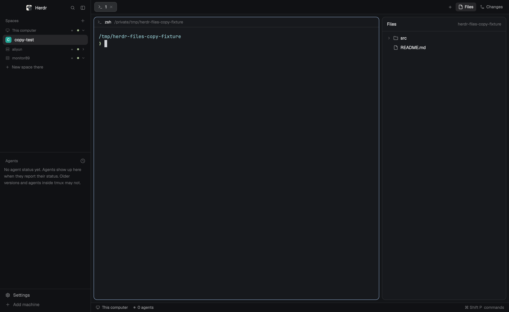

# Along panels

The Files and Changes panels from Along, with a right-click menu that copies a file's absolute path, its path relative to the shown folder or the repository root, or its name. Install this instead of the whole Along layout when you only want the copy-path panels.

This file is the brief: enough to build Along panels from an empty folder. The
files next to it are one build of it. If they don't work on your Herdr, or you
want it different, build it again from here.

## What you see

No layout of its own: this is four mods you drop into the window you already
have. The Files panel docks on the right, 368px wide, the first time Herdr
sees it in a personal layout.

- **The Files panel.** A rounded 10px card on the theme background with a 1px
  border and 13px text. Header 42px: "Files" in semibold, a "Machines" chip
  (11px, muted, rounded 5px, hover tint) and the shown folder's name
  right-aligned in dim 12px. Rows are 28px, indented 18px per depth: a 12px
  chevron for a folder (12px of blank for a file), a 14px folder or file
  icon, the name, and, when git reports one, a status letter — `A` green,
  `D` and `U` red, `M` in the blocked color.
- **The Changes panel.** The same card. Header 42px: "Changes" in semibold,
  the "Machines" chip, a bordered "N files" chip in 10px, then the total
  additions in green and deletions in red, both 11px. The changed-file list
  is at most 200px tall with 28px rows: the status letter in a 14px column,
  the directory prefix in dim text, the file name, and that file's own
  `+`/`−` counts. Below it the selected file's unified diff, 11px monospace
  on 20px rows, with a vertical scrollbar and horizontal scrolling; diff
  lines are never wrapped. Its commit bar sits at the bottom: a 32px message
  input and a 32px "Commit" button.
- **The right-click menu.** A 210px popup with 5px padding on the theme's
  popover color and 12.8px text. Rows are 31px high with a 14px copy icon:
  "Copy Path", "Copy Relative Path", "Copy Name". A row whose value is empty
  or repeats an earlier row is dropped.
- **The Machines dialog.** 460×360, popover color, 12px padding, 13px text. A
  heading row "Machines" with "enable / disable" in dim 11px, then one 36px
  row per machine: a 7px dot (green when enabled, dim when disabled), the
  machine name, a second line with its state or "disabled" in dim 11px, and a
  "Disable" or "Enable" button in 11px.

## How it behaves

- Right-clicking any row in Files or Changes opens the menu for that row. In
  Files it works on folders and files; in Changes on changed files.
- "Copy Path" is absolute (`/home/me/project/src/main.js`, or
  `C:\work\project\src\main.js` on Windows). "Copy Relative Path" is relative
  to the folder the Files panel is showing, and in Changes relative to the
  repository root. "Copy Name" is the last path segment. The chosen value goes
  to the system clipboard and the menu closes.
- The menu takes focus when it opens, so keys go to it and not to the
  terminal behind it. Up and Down move the highlight, Enter copies, Escape
  closes.
- Path separators follow the platform: `/` on macOS and Linux, `\` on
  Windows.
- Files follows the focused pane's folder, reloads every 10 seconds and when
  the folder changes on disk, and remembers which folders are expanded per
  space. Clicking a folder expands it, clicking a file shows a read-only
  preview with syntax coloring, and "←" goes back to the list.
- Changes lists the repository's uncommitted files and shows the selected
  file's diff. Clicking a row opens its diff, clicking it again closes it.
- "Machines" opens the dialog from either panel header. It reads the machines
  herdr-core knows with `hc machine ls --json`. "Disable" removes the machine
  with `hc machine rm` and keeps its profile in local storage; "Enable" adds
  it back with `hc machine add` and the saved target and session.
- Nothing animates, and the panels show no agent status.

## Built from

- **Four mods and no `layouts/` folder**, so installing this never changes the
  window's structure by itself:
  - `along-files/` — the shipped `files` mod plus `openOverlay`, the
    `windows`/`joiner` path helpers, a `rowMenu(path, entry)` method, an
    `.on_mouse_down("right", …)` on each row, the "Machines" chip in the
    header, and its own asset paths (`mods/along-files/…`). `mod.json` is
    `{ "place": "right", "size": 368 }`, which docks it once.
  - `along-changes/` — the shipped `changes` mod with the same additions,
    its relative path measured from the repository root. `mod.json` is
    `{ "place": "none" }`: add it to a layout yourself, as a `stack` with
    Files, to see it.
  - `along-menu/` — the popup. Reads `props().target` (`path`, `relative`,
    `name`) and `props().overlay`, writes with `cx.write_to_clipboard`, closes
    with `closeOverlay`. `place: "none"`; only `openOverlay` shows it.
  - `along-machines/` — the dialog. Reads with `exec("hc", ["machine", "ls",
    "--json"])`, writes with `hc machine rm` and `hc machine add`, and keeps
    disabled profiles in `localStorage` under `along.machines.disabled`.
    `place: "none"`.
- **Data:** `spaces()`, `panes()` and `focused()` for the folder and the
  remote machine, `theme()` for every color, `settings()` for the preview
  font, `window()` for the platform.
- **Commands and programs:** `openOverlay` and `closeOverlay`; `exec("sh")`
  or `exec("powershell")` to list a folder; `exec("git")` for the root,
  status, diffs, `add` and `commit`; `exec("hc")` for machines;
  `readTextFile` for previews; `watchFolder` for live refresh.
- **Art:** four SVGs in `along-files/` (chevron down, chevron right, file,
  folder) and one copy icon in `along-menu/`.

## Watch out

- **The Changes panel writes to your repository.** Its Commit button runs
  `git add -A` and then `git commit -m <message>` in the repository root, so
  it stages everything, not only the rows you looked at. Drop the commit bar
  if you don't want that.
- The Machines dialog runs `hc` and can remove machines from herdr-core. A
  disabled machine's spaces disappear from the window until it is enabled
  again; its terminals keep running in the core.
- `place: "right"` only docks while a personal layout is shown. On a shipped
  layout (`main`, `terminals`, `win98`) a new mod with a place is skipped, so
  duplicate a layout first (`layout.clone`) or add a block that shows
  `along-files` yourself.
- Along panels is not a layout. It does not bring the sidebar, tab bar or
  terminal frame; it only adds the two panels and their overlays.
- These are copies of the shipped `files` and `changes` mods, so they do not
  follow upstream fixes. When Herdr updates, re-copy `defaults/mods/files/`
  and `defaults/mods/changes/` and re-apply the right-click additions. This
  copy was synced against herdr-app 0.1.11.
- The `mods/along-files/…` asset paths and the `mod` names in the two
  `openOverlay` calls name the same four folders; renaming one means changing
  all of them.
- The Files panel caps at 500 entries per folder and 5,000 overall; Changes
  caps at 1,000 changed files. A preview is limited to 400,000 characters, and
  a file containing a NUL byte is reported as binary.
- Remote (SSH) machines list folders, run git and read previews through `hc`,
  so the same menu works there; only the path separator rule follows the local
  platform.

## Done when

- `herdr-app check mods/along-files`, `mods/along-changes`, `mods/along-menu`
  and `mods/along-machines` pass.
- In a personal layout, the Files panel appears on the right after Herdr
  restarts, and follows the focused pane's folder.
- Right-clicking a file row opens the menu; each item puts the right string on
  the clipboard, and "Copy Relative Path" starts at the shown folder.
- With Changes added as a `stack` next to Files, right-clicking a changed file
  copies paths relative to the repository root.
- Up, Down, Enter and Escape work in the menu, and the terminal receives keys
  again once it closes.
- "Machines" opens the dialog; Disable takes a machine out of `hc machine ls`
  and Enable brings it back with its target.
