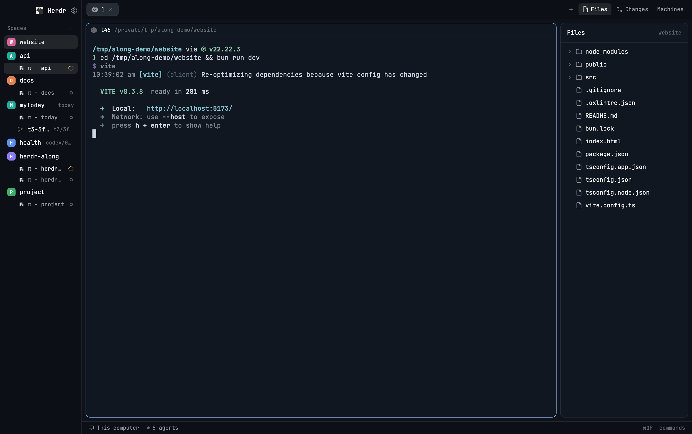

# Along

Along adds right-click path copying to Herdr's Files and Changes panels, a
Machines button for herdr-core machines (with adding built into its dialog),
and explicit controls for floating a pane and returning it to the workspace,
and names for panes and their agents. Its sidebar puts each space's agents
under the space's own row, one list with a state mark per agent.

Version 0.4.11. See [CHANGELOG.md](CHANGELOG.md) for what changed.

This file is the brief: enough to build Along from an empty folder. The
files next to it are one build of it. If they don't work on your Herdr, or you
want it different, build it again from here.

## What you see

Herdr's default window, with Along's Files and Changes path menu, Machines
button, and Float controls and click-to-rename names in pane headers.

- **The window.** No title bar. A 268px sidebar on the left: a 46px brand
  block, then one spaces list (at least 90px) that carries each space's agents
  under its row. When the
  sidebar is collapsed, its expand button comes first in the
  compact spaces rail, before the new-space button. A tab bar 42px tall with
  the terminal tabs, a `+`, and Files,
  Changes and Machines buttons at the right, then the pane area, then a
  28px status bar.
  On the right, a panel column 368px wide (min 280, max 900), hidden until a
  panel is opened, holding Files and Changes as a stack with Files in front.
  Terminals get 14px of horizontal and 12px of vertical padding, and panes
  are 10px-radius cards with a 1px border that turns into the accent color
  when focused. A floated pane's window repeats that accent border and
  10px radius around the float bar and terminal.
- **The Files panel.** A rounded 10px card on the theme background with a 1px
  border and 13px text. Header 42px: "Files" in semibold and the shown
  folder's name — or, while a file is open, that file's path — right-aligned in
  muted 12px. Rows are 28px, indented 18px per
  depth: a 12px chevron for a folder (12px of blank for a file), a 14px
  folder or file icon, the name, and, when git reports one, a status letter —
  `A` green, `D` and `U` red, `M` in the blocked color.
- **The Changes panel.** The same card. Header 42px: "Changes" in semibold,
  a bordered "N files" chip in 10px, then the total additions in green and
  deletions in red, both 11px. The changed-file list is at most 200px tall
  with 28px rows: the status letter in a 14px column, the directory prefix in
  muted text, the file name, and that file's own `+`/`−` counts. Below it the
  selected file's unified diff, 11px monospace on 20px rows, with a vertical
  scrollbar and horizontal scrolling; diff lines are never wrapped.
- **The commit bar.** At the bottom of Changes, a 32px rounded message input
  and a 32px "Commit" button, which reads "Commit 3 files" when the panel
  lists more than one. The button is filled with the theme's solid color
  only when the message is non-empty, the panel lists at least one changed
  file, and no other git work is running.
- **The pane right-click menu.** 280×260, popover color, 12.8px text, 31px
  rows with a 14px icon and the key hint on the right: Split right, Split
  down, Zoom (Unzoom when the pane is zoomed), Send right-clicks to pane,
  Send back to a parent, Close pane, with a separator above Close. Split
  right/down and Zoom/Unzoom use the pane header's own icons.
- **The Files and Changes right-click menu.** A 210px popup with 5px padding
  on the theme's popover color and 12.8px text. Rows are 31px high with a
  14px copy icon: "Copy Path", "Copy Relative Path", "Copy Name". A row whose
  value is empty or repeats an earlier row is dropped, so the menu can show
  fewer than three.
- **The Machines dialog.** 460×380, popover color, 12px padding, 13px text. A
  heading row "Machines" with "enable / disable" in muted 11px and a "+ Add
  machine" button that opens the machine-add dialog, then one 36px
  row per machine: a 7px dot (green when enabled, muted when disabled), the
  machine name, a second line with its state — underscores read as spaces, so
  `needs_login` shows as `needs login`, the same as the sidebar's machine row —
  or "disabled", in muted 11px, and a "Disable" or "Enable" button in 11px.

## How it behaves

- Right-clicking a pane (or Shift+right-clicking a terminal whose program
  takes the mouse) opens Along's pane menu, with the pane header's split and
  zoom icons and the bound key on the right.
- Right-clicking any row in Files or Changes opens the menu for that row. In
  Files it works on folders and files; in Changes on changed files.
- "Copy Path" is absolute (`/home/me/project/src/main.js`, or
  `C:\work\project\src\main.js` on Windows). "Copy Relative Path" is relative
  to the folder the Files panel is showing, and in Changes relative to the
  repository root. "Copy Name" is the last path segment. The chosen value goes
  to the system clipboard and the menu closes.
- The menu takes focus when it opens, so keys go to it and not to the
  terminal behind it. Up and Down move the highlight, Enter copies, Escape
  closes. When it closes, typing reaches the terminal again.
- Path separators follow the platform: `/` on macOS and Linux, `\` on
  Windows, so a copied relative path pastes into that platform's shell.
- Files follows the focused pane's folder, reloads every 10 seconds and when
  the folder changes on disk, and remembers which folders are expanded per
  space. Clicking a folder expands it, clicking a file shows a read-only
  preview with syntax coloring, and "←" goes back to the list.
- Changes lists the repository's uncommitted files and shows the selected
  file's diff. Clicking a row opens its diff, clicking it again closes it.
- "Machines" opens the dialog from the tab bar. It reads the machines
  herdr-core knows with `hc machine ls --json`, again every two seconds while
  the dialog is open, so a machine added through the heading's "+ Add
  machine" entry appears on its own. "Disable" removes the machine
  with `hc machine rm` and keeps its profile in shared state; "Enable" adds it
  back with `hc machine add` and the saved target and session. The row shows
  "Working…" while the command runs.
- Nothing animates. The spaces list is the shipped `spaces` mod plus the
  agents list folded into it: every space's row is followed by its own
  agents.

## Spaces and agents in one list

- Each space's row is followed by its agents: the program icon (it folds the
  agent's sub-agent tree when clicked), the agent's name (its own title, else
  the tab's), the machine name when remote, and a small state mark — a
  spinner while working, a `!` in the blocked colour when blocked, a dot
  when done, a dot when the agent errored, an open ring when idle. An agent program that reports no
  status (no OSC 7501) gets a plain grey mark: it is running, only its state is
  unknown.
  Clicking a row focuses the agent's pane; clicking an icon
  of a sub-agent without a pane peeks at it.
- **State colours.** Every mark and every name takes its colour from one
  traffic-light palette: working `#4ade80`, done `#3fae6a`, blocked
  `#e3814f`, error `#ff5f66`, idle `#9b9b9b`. The pane header's name, the
  agent row's name and the float bar's name all take their state's colour,
  and focusing a row does not replace it: focus is the row's background only.
  On a light surface the same hues come as dark ink — working `#146b30`, done
  `#2a7a2e`, blocked `#855700`, error `#c62a2a`, idle `#636a74` — because
  the bright hues sit at 1.7 to 2.8:1 on white; the background's own
  brightness picks the set. The same helper is copied into `along-pane`,
  `along-spaces` and `along-float` (each mod loads on its own).
  The numbers are picked by contrast, not by eye: an agent's name *is* written
  in its state colour, so every hue has to clear AA's 4.5:1 on the surfaces it
  lands on. The dark set clears 4.5:1 on the panel background (6.4 to 10.8:1),
  on a raised row and on the selected row. The light set clears it on the
  panel background and on a raised row (4.7 to 6.1:1); on the selected row
  the deeper greens and greys sit at 4.0 to 4.2:1, which is the one place
  the light palette still falls short.
- **Key text is muted, never dim.** Text that carries meaning — a section
  heading, a label, a count, a machine name, a folder path, a diff's line
  numbers — uses the theme's `muted` colour: 4.8:1 to 6.6:1 on the surfaces
  it lands on, so it clears AA. `dim` (2.6:1 to 3.5:1) is kept only for what
  is genuinely inert: a disabled button's label, and the editor's syntax
  colours, which come from the theme's own highlighter.
- **Icon-only controls are named.** A control with no text of its own — the
  pane header's Float, Split right, Split down, Zoom/Unzoom, Close and `⋯`,
  the float bar's drop icon, four arrows and `✕`, the brand row's Settings,
  Search, `⋯` and sidebar toggle, the tab bar's `+` and window buttons and a
  tab's `✕`, the Files panel's `←`, the sidebar's New space, Expand sidebar and
  fold arrows, a machine's `⚠` and `+` — carries `role("button")` and an
  `accessibility_label`; a tooltip is not a substitute. The local `button()`
  helper in each mod takes what is drawn and what is announced as two
  arguments, so the two never get confused. A space's "needs you" badge is
  announced as "2 need you", not "2". A selected space or agent row is
  `role("list_box_option")` with `aria_selected`, and the list's container
  stays a plain `v_flex` because there is no arrow-key path inside it yet — the
  app's `agent.next`/`agent.prev` follow the list through `setAgentOrder`. The
  pane header's five buttons are built only while the header is hovered, so a
  screen reader finds them only then. A machine's group row is the one
  exception: expanded it reads its machine name, collapsed it draws only an
  icon, and one label cannot serve both forms.
- **User-facing text is English; Chinese is comments only.** Every string a
  person can read — a label, a tooltip, a notice — is English, so the window
  reads as one language; Chinese in the source explains why the code does what
  it does and never reaches the screen.
- **Needs you.** Agents that reported `blocked` or `error` also gather
  at the top of the list, above the spaces, under a "Needs you" heading with
  their number: one row each, named by its space and its own name, so an
  agent waiting in another space shows up without opening that space. The
  space that holds them carries the same number as a badge on its row, in
  the blocked colour, with the tooltip "2 need you". The list under each
  space is unchanged — the agent still sits where it belongs, so the
  heading is a summary over the tree, not a move out of it. The collapsed
  rail shows neither.
- **A space's own colour.** A space's avatar is a rounded tile with the
  space's first letter in dark ink (`#15181d`) on one strong colour per hue:
  `ansi6` `#22a99a`, `ansi3` `#c08a2e`, `ansi4` `#5b8def`, `ansi5`
  `#8b7cf6`, `ansi2` `#6f9e2f`, `ansi1` `#d9649a`. These are the
  space's identity, not the theme's: they are the same on every theme and
  they do not follow the skin. A space stores colour *names* (`ansi3`), so
  a name the theme does not know falls back to the theme's own ansi colour.
  They deliberately never reuse a state colour: an orange avatar, an orange
  "needs you" badge and an orange blocked agent all sit on one space row,
  and one colour for all three says nothing — `ansi3` and `ansi2` used to
  be exactly the blocked and done colours, and are now ochre and olive, the
  nearest state colour 49 and 78 away in RGB. The letter is dark ink because
  the tile is a background: white on these hues is 2.8:1, the ink 5.3 to
  6.1:1.
- **Tree lines.** A 1px `border` line drops from the space row's icon centre
  through a 4px gap and down the left of its agent rows, with a short
  horizontal stub into each row's icon; the last row ends it. The gap keeps
  the space's rounded background from touching the first agent's.
- The list keeps itself: an agent that starts, ends, moves to another space
  or changes state redraws the rows under its space without waiting for
  something else to change. The focused agent's row is highlighted.
- An agent is listed under the space its own pane is in; a floated one
  (a float, "Send back") keeps the space it was parked from.
- A name given to a pane or an agent row reads the same in both places and
  in the float bar. A click on the pane header's name, or a right-click on
  an agent row, edits it in place: Enter saves, Escape cancels, clicking
  away keeps the text. Names live in `shared("along.names")`, keyed by the
  terminal's address (`t:<address>`) or the pane (`p:<pane>`); clearing one
  restores the automatic name.
- Indentation follows the space's own: a main checkout's row sits at 8px so
  its agents go to 32px and their sub-agents to 50px; a worktree's row sits
  at 22px past its branch icon, so its agents go to 46px and their
  sub-agents to 64px. A worktree row keeps its place after the main
  checkout's agents and carries its own agents one level deeper.
- Agents sort pinned-first, then urgent-first (blocked, done, working, idle),
  the most recent change breaking ties. Agents of no listed space (a machine
  away, or a space that closed under them) gather at the end under
  "Elsewhere", each named by its space. Agents waiting for you are also
  gathered at the top, under "Needs you". The collapsed rail shows spaces
  only, as before. The standalone agents list is gone: the layout no longer
  mounts `along-agents`, and the priority/grouped sort menu went with it.

## Built from

- **The layout**, `layouts/along.json`: a copy of the shipped `main` tree with
  `titlebar: "none"`, `terminal_menu: "along-pane-menu"`, `traffic_lights:
  [12, 16]`, `terminal_padding: [14, 12]` and a 1px `border` divider. Its
  right column is `hidden: true`,
  368px, min 280, max 900, and holds a `stack` with `active: "files"` and two
  blocks, `content: { mod: "along-files" }` and `content: { mod:
  "along-changes" }`. The tab bar points at `along-tabs` and the pane header
  at `along-pane` instead of the shipped mods. Everything else points at
  shipped mods:
  `along-chrome` (brand), `along-spaces` (spaces with their agents), `pane`,
  `workspace-status`.
- **Eleven mods**, all `"place": "none"` so only the layout decides where they
  show:
  - `along-chrome/` — the shipped `workspace-chrome` mod with a Settings
    button in the brand row, left of the search button; it carries the
    update-ready dot the footer's Settings row used to show. There is no
    footer: adding a machine lives in the Machines dialog now. Below 236px of
    sidebar (but above the 160px rail) the three buttons fold into one `⋯`
    that opens `along-menu` with the same three actions.
  - `along-pane/` — the shipped `pane` header mod plus a Float button and an
    in-place rename input: the name it shows is `shared("along.names")`'s
    entry for the pane, else the program's or the terminal's own. It probes
    the pane's neighbors with `pane.focus` + `pane.go` (left, up,
    right, down), records them with the source space and tab in
    `shared("along.floats.origins")`, then parks the pane's terminal with
    `terminal.park` (the terminal keeps running without a pane) and opens a
    `kind: "window"` overlay whose layout holds the along-float bar and a
    `{ terminal }` block. The layout root carries the pane's selected look:
    `border: { width: 1, color: "accent" }` and `radius: 10`, so the float
    reads as the focused pane. Main-pane clicks record the current target by tab
    in `shared("along.floats.targets")`. Herdr does not expose a reliable
    dragged-overlay rectangle or all pane rectangles, so Along deliberately
    does not infer a drop target from the float's visual position.
  - `along-pane-menu/` — the pane right-click menu. The app opens it because
    the layout root sets `terminal_menu`. It keeps the shipped pane items and
    key hints; Split right/down and Zoom/Unzoom draw `mods/along-pane/…` so
    the menu matches the pane header, and Zoom reads the pane's `zoomed` state
    to show Unzoom. The rest of the icons come from `mods/workspace-chrome/`.
  - `along-float/` — the floating window's bar, a copy of the shipped
    `peek` bar. Shows the program icon, the custom name (else its own) and
    agent status; the four
    direction buttons return the terminal beside the currently focused pane
    (then the per-tab remembered target, then the recorded source neighbor
    as fallback). The direction is explicit because the overlay's visual
    position is not exposed reliably by the mod API. The drop icon is a
    default-right action, and every return waits for `terminal.keep` to
    create a pane before closing the overlay. "✕" leaves the terminal
    parked and discards its float origin.
  - `along-files/` — the shipped `files` mod plus `openOverlay`, the
    `windows`/`joiner` path helpers, a `rowMenu(path, entry)` method, an
    `.on_mouse_down("right", …)` on each row, and its own asset paths
    (`mods/along-files/…`).
  - `along-changes/` — the shipped `changes` mod with the same additions,
    its relative path measured from the repository root.
  - `along-tabs/` — the shipped `tabs` mod with a "Machines" button added
    after the Files and Changes buttons.
  - `along-menu/` — the popup. Reads `props().target` (`path`, `relative`,
    `name`) and `props().overlay`, writes with `cx.write_to_clipboard`, closes
    with `closeOverlay`. Given `props().target.actions` instead (a list of
    `{ label, icon, run }`), it draws those and runs the chosen one: the
    brand row's `⋯` uses this.
  - `along-machines/` — the dialog. Reads with `exec("hc", ["machine", "ls",
    "--json"])`, writes with `hc machine rm` and `hc machine add`, and keeps
    disabled profiles in shared state under `along.machines.disabled`. It
    migrates profiles from older per-overlay stores on first open.
  - `along-spaces/` — the shipped `spaces` mod with the sidebar expand button
    at the start of the compact rail, and the agents list folded in: each
    space's row is followed by its agents (see "Spaces and agents in one
    list"). It reads `agents()`, `terminals()`, `focused()` and
    `knownAgents()`, sorts with the agents list's urgency ranking, and
    calls `setAgentOrder` in the spaces' order so keyboard navigation keeps
    working. `knownAgents()` is what tells it which programs the app can
    start as agents (the `run` entries in programs.json), so an agent CLI
    added by hand gets a row even when it reports no status.
  - `along-agents/` — the shipped `agents` mod without the expand button that
    used to sit at the bottom of the compact rail. No longer mounted by the
    layout; kept in the repo for reference and possible return.
- **Data:** `spaces()`, `panes()` and `focused()` for the folder and the
  remote machine, `agents()` and `terminals()` for the agents under each
  space, `knownAgents()` for the programs the app can start as agents,
  `theme()` for every color, `settings()` for the preview
  font, `window()` for the platform.
- **Commands and programs:** `openOverlay` and `closeOverlay`; `exec("sh")`
  or `exec("powershell")` to list a folder; `exec("git")` for the root,
  status, diffs, `add` and `commit`; `exec("hc")` for machines;
  `readTextFile` for previews; `watchFolder` for live refresh.
- **Art:** four SVGs in `along-files/` (chevron down, chevron right, file,
  folder) and one copy icon in `along-menu/`. They are the shipped panels'
  icons.
- **Program icons**, `program-icons/` (optional): two PNGs that give CodeBuddy
  and MiniMax Code their own mark in the app's program table, where both
  otherwise show the generic `icons/agent.svg`. Herdr has no entry for either
  program and `icons/` belongs to Herdr, so the files go into
  `~/.config/herdr-app/my-icons/` and two entries are merged into
  `programs.json` (per-machine config). The layout and the mods never
  reference them: leave the folder out and Along is unchanged. `install.sh`
  there does both steps (it creates `my-icons/` and `programs.json` on a
  machine that has neither, backs the file up, and only replaces those two
  entries); `program-icons/README.md` has the same steps by hand.

## Watch out

- **The Changes panel writes to your repository.** Its Commit button stages
  the paths the panel lists (`git add -- <paths>`, a hundred at a time) and
  then runs `git commit -m <message>` in the repository root, so the commit
  carries the changes the panel showed, not every change in the worktree. It
  still carries the whole panel, not the one row you were reading, and
  anything you had staged yourself goes in with it. Drop the commit bar if
  you don't want that.
- **`dim` still sits on three things that are read**, against the rule above:
  the tab bar's icon buttons (`+`, the window buttons, a tab's `✕`), the pane
  menu's key hints, and the float bar's mark for an agent that reports no
  status. At 2.6:1 to 3.5:1 they are under AA for text and at the edge of
  3:1 for a control. The rest of `dim` — a disabled button's label and the
  editor's syntax colours — is inert, which is what it is for.
- The Machines dialog runs `hc` and can remove machines from herdr-core. A
  disabled machine's spaces disappear from the window until it is enabled
  again; its terminals keep running in the core.
- These are copies of the shipped `files`, `changes`, `tabs` and `menu` mods,
  so they do not follow upstream fixes. When Herdr updates, re-copy
  `defaults/mods/files/`, `defaults/mods/changes/`, `defaults/mods/tabs/` and
  `defaults/mods/menu/` and re-apply the right-click, Machines and icon
  additions. The panels were synced against herdr-app 0.1.11; the pane menu
  against 0.1.16.
- The `mods/along-files/…` asset paths, the `mod` names in the layout and the
  `mod` names in the `openOverlay` calls all name the same five folders.
  Renaming any of them means changing all of them.
- The Files panel caps at 500 entries per folder and 5,000 overall; Changes
  caps at 1,000 changed files. A preview is limited to 400,000 characters, and
  a file containing a NUL byte is reported as binary.
- Remote (SSH) machines list folders, run git and read previews through
  `hc`, so the same menu works there; only the path separator rule still
  follows the local platform.
- The panels are read-only apart from the commit bar. There is no create,
  rename, delete or drag.

## Done when

- `herdr-app check mods/along-files`, `mods/along-changes`, `mods/along-menu`,
  `mods/along-machines`, `mods/along-tabs`, `mods/along-pane`,
  `mods/along-pane-menu`, `mods/along-float`, `mods/along-spaces` and
  `mods/along-chrome` pass.
- Switching to `along` (`ctrl-shift-l`, or `layout.switch along`) shows the
  sidebar, the tab bar with Machines next to Files and Changes, the terminals
  and the right panel with Files in front.
- Right-clicking a pane opens the pane menu; Split right/down and Zoom match
  the header's icons, and a zoomed pane reads Unzoom.
- Right-clicking a file row in Files opens the menu; each item puts the right
  string on the clipboard, and "Copy Relative Path" starts at the shown
  folder.
- Right-clicking a changed file in Changes copies paths relative to the
  repository root.
- Up, Down, Enter and Escape work in the menu, and the terminal receives keys
  again once it closes.
- "Machines" opens the dialog; Disable takes a machine out of `hc machine ls`
  and Enable brings it back with its target.
- Hovering a pane header shows the Float button; clicking it removes the
  pane from the layout and opens a draggable floating window holding the
  same terminal, with the along-float bar on top and the focused pane's 1px
  accent border around the whole window. While it is preparing,
  the drop controls are disabled. Click a main-layout pane to focus the
  desired target, then use `←`, `→`, `↑` or `↓` to split the terminal beside
  that target. If no target is available, the chosen direction is tried
  against the recorded source neighbors; if those are unavailable, a new
  tab is used. The drop icon is the default-right action. Every return waits
  for `terminal.keep` to create the pane before closing the window. `✕`
  leaves the terminal parked and discards the source record; the agents
  list can bring it back. The overlay position is remembered only by the
  host window; Along does not use it to infer a drop target.
- Switching to another layout and back keeps the panels, and Files still
  follows the focused pane's folder.
- An agent that starts, finishes or changes state shows up under its space
  without touching the window, and a pane running an agent program that
  reports no status gets a row with a dim mark.
